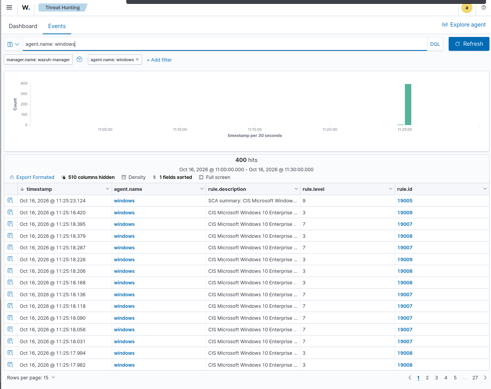

# Validation des événements de sécurité Windows

## Observation

Le filtre Wazuh `agent.name: windows` et `data.win.system.channel: Security`
retourne deux événements de connexion réussie.

| Élément | Valeur |
|---|---|
| Agent | windows |
| Adresse IP | 192.168.10.40 |
| Description | Windows Logon Success |
| Règle | 60106 |
| Niveau | 3 |
| Nombre observé | 2 |

## Qualification

Événements informatifs de niveau faible. Aucun incident confirmé sur la base
de ces seuls événements.

## Capture

